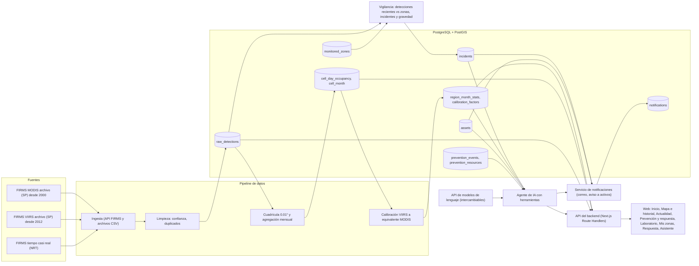

# Arquitectura

Refleja el diagrama «Arquitectura y flujo de datos FIRMS» del tablero de Miro, con las funciones de monitoreo, respuesta y agente de IA integradas.

## 1. Vista general

## 2. Componentes

| Componente | Responsabilidad | Ubicación |
|---|---|---|
| Cliente FIRMS | Llamadas a la API de FIRMS con throttle, reintentos y parseo de CSV | `src/lib/firms/` |
| Pipeline de armonización | Limpieza, cuadrícula, agregados, calibración, estadísticas (funciones puras) | `src/lib/harmonize/` |
| Vigilancia | Compara detecciones nuevas con zonas, agrupa incidentes, calcula gravedad y expansión | `src/lib/alerts/` |
| Notificaciones | Plantillas, dedupe, envío por `EmailProvider`, registro en `notifications` | `src/lib/email/`, `src/lib/alerts/` |
| Agente de IA | Adaptador `LLMProvider`, bucle de herramientas, políticas, auditoría | `src/lib/agent/` |
| Geo | Utilidades espaciales, rutas, lugares seguros | `src/lib/geo/` |
| API | Endpoints REST (ver `API.md`) | `src/app/api/` |
| Web | Páginas y componentes (ver `PAGINAS-UI.md`) | `src/app/`, `src/components/` |

## 3. Stack y decisiones

| Capa | Elección por defecto | Motivo |
|---|---|---|
| Aplicación | Next.js (App Router) + TypeScript | Un solo proyecto para web y API, despliegue sencillo |
| Base de datos | Supabase (PostgreSQL + PostGIS) | Consultas espaciales, autenticación y RLS integrados |
| Autenticación | Supabase Auth con enlace mágico por correo | Sin contraseñas, suficiente para el MVP |
| Mapas | MapLibre GL JS con teselas abiertas | Sin clave obligatoria ni costo |
| Gráficas | Calendario propio (CSS grid) y Recharts o visx | Control total de la cuadrícula años × meses |
| Correo | Resend detrás de `EmailProvider` | Cambiable por SMTP |
| IA | Vercel AI SDK detrás de `LLMProvider` | Un mismo código para varios proveedores y llamadas a herramientas |
| Programador | `pg_cron` + `pg_net` de Supabase, o el programador del hosting, llamando a `/api/jobs/*` | Tareas periódicas sin servidor propio |
| Pruebas | Vitest y Playwright | Estándar en el ecosistema |

Las decisiones abiertas están en `DECISIONES.md`.

## 4. Flujos principales

### 4.1 Ingesta histórica (una vez, y reconciliación mensual)
1. `pnpm ingest:backfill` descarga `MODIS_SP` y `VIIRS_SNPP_SP` para la región de ingesta (archivo CSV del sitio de descargas de FIRMS, o API por ventanas de 5 días con throttle).
2. Limpieza y asignación de `cell_id`.
3. Agregación a `cell_day_occupancy` y `cell_month`.
4. `pnpm stats:recompute` calibra y llena `region_month_stats`.

### 4.2 Ingesta en tiempo casi real (cada 15 minutos)
1. `POST /api/jobs/ingest-nrt` consulta los orígenes NRT de VIIRS (S-NPP, NOAA-20, NOAA-21) y MODIS para la región de ingesta, últimos 2 días.
2. Inserta en `raw_detections` ignorando duplicados.
3. Llama a la evaluación de zonas con las detecciones nuevas.

### 4.3 Alerta por zona (Función 1)
1. `evaluate-zones` cruza detecciones nuevas con `monitored_zones` activas y verificadas.
2. Crea o actualiza el incidente correspondiente.
3. Si el incidente es de gravedad baja y no requiere agente: envío automático con plantilla.
4. Si requiere agente: se marca `needs_agent` y se dispara el agente (ver 4.4).

### 4.4 Respuesta con activos cercanos (Función 2) y agente
1. Un incidente nuevo, en expansión o de gravedad media o alta dispara una ejecución del agente.
2. El agente consulta el incidente, el contexto histórico y `assets` cercanos disponibles.
3. Redacta avisos. Según `AGENT_AUTONOMY`, los envía o los deja pendientes de aprobación humana.
4. Todo queda en `agent_runs`, `agent_tool_calls` y `notifications`.

### 4.5 Asistente de apoyo y planificación
Chat desde cualquier página. Herramientas de lectura y ayuda (primeros auxilios desde `kb/`, rutas, lugares seguros, contexto de prevención). Las acciones con efectos pasan por la política de `AGENTE-IA.md`.

## 5. Tareas programadas

| Tarea | Frecuencia sugerida | Endpoint |
|---|---|---|
| Ingesta NRT | cada 15 min | `/api/jobs/ingest-nrt` |
| Evaluación de zonas | tras cada ingesta | `/api/jobs/evaluate-zones` |
| Reconciliación SP (reemplaza NRT por datos estándar) | mensual | `/api/jobs/reconcile-sp` |
| Recalcular estadísticas | diaria | `/api/jobs/recompute-stats` |
| Limpieza de retención | diaria | `/api/jobs/retention` |

Todos requieren el encabezado `Authorization: Bearer ${CRON_SECRET}`, son idempotentes y registran inicio, fin y conteos.

## 6. Variables de entorno

| Variable | Uso |
|---|---|
| `APP_BASE_URL` | URL pública (enlaces en correos) |
| `NEXT_PUBLIC_SUPABASE_URL`, `NEXT_PUBLIC_SUPABASE_ANON_KEY` | Cliente de Supabase en el navegador |
| `SUPABASE_SERVICE_ROLE_KEY` | Solo servidor, tareas e integraciones |
| `DATABASE_URL` | Conexión directa para migraciones y scripts |
| `FIRMS_MAP_KEY` | Clave gratuita de FIRMS (solo servidor) |
| `INGEST_BBOX` | Caja de ingesta `oeste,sur,este,norte` (por defecto, República Dominicana con margen) |
| `CRON_SECRET` | Autoriza `/api/jobs/*` |
| `EMAIL_PROVIDER`, `EMAIL_API_KEY`, `EMAIL_FROM` | Envío de correo |
| `DEMO_MODE` | `true` redirige avisos a instituciones a `DEMO_INBOX` |
| `DEMO_INBOX` | Correo de pruebas |
| `LLM_PROVIDER`, `LLM_MODEL`, `LLM_API_KEY` | Modelo de IA principal |
| `LLM_FALLBACK_PROVIDER`, `LLM_FALLBACK_MODEL`, `LLM_FALLBACK_API_KEY` | Modelo alterno (opcional) |
| `AGENT_AUTONOMY` | `suggest` (por defecto) o `auto` |
| `ROUTING_API_URL`, `ROUTING_API_KEY` | Servicio de rutas |
| `WEATHER_API_URL` | Datos de viento y clima (opcional) |
| `MIN_CONFIDENCE` | Confianza mínima para el índice (`nominal` por defecto) |
| `SP_LAG_DAYS` | Antigüedad desde la cual un mes usa datos SP (90 por defecto) |
| `MIN_ACTIVITY` | Actividad mínima (CDO) para clasificar el estado de un mes (5 por defecto) |
| `HARMONIZATION_STRATEGY` | `viirs_from_2012` (por defecto) o `modis_anchor` |
| `MAX_AOI_KM2` | Área máxima de una zona de consulta (60000 por defecto) |
| `MAX_ZONES_PER_USER`, `MAX_ZONE_KM2` | Límites de zonas de monitoreo (10 y 5000 por defecto) |
| `INCIDENT_RADIUS_KM`, `INCIDENT_WINDOW_HOURS` | Agrupación de incidentes (2 km y 24 h por defecto) |
| `MAX_ASSET_NOTIFICATIONS_PER_HOUR` | Tope de avisos a instituciones por hora (10 por defecto) |

Mantén `.env.example` con todas, sin valores reales.

## 7. Seguridad

- RLS en todas las tablas con datos de usuario (ver `MODELO-DE-DATOS.md`).
- Roles: `anonymous`, `user`, `coordinator`, `admin`.
- Límites de tasa: chat anónimo por IP, creación de zonas, correos por hora.
- Validación con `zod` en cada endpoint y en cada herramienta del agente.
- Registro de auditoría de acciones del agente y de aprobaciones humanas.

## 8. Observabilidad

- Logs estructurados (sin datos personales) con `run_id`, `incident_id` y `job` cuando aplique.
- Tabla `job_runs` con resultado de cada tarea programada (inicio, fin, filas leídas, filas nuevas, error).
- `GET /api/health` informa base de datos, fecha de la última ingesta y estado del proveedor de correo.

## 9. Despliegue

- Aplicación en un hosting compatible con Next.js; base de datos en Supabase.
- Entornos: `local`, `staging` y `production`. En `staging` y en la demostración `DEMO_MODE=true`.
- Migraciones versionadas en `supabase/migrations/`, aplicadas por `pnpm db:migrate`.
